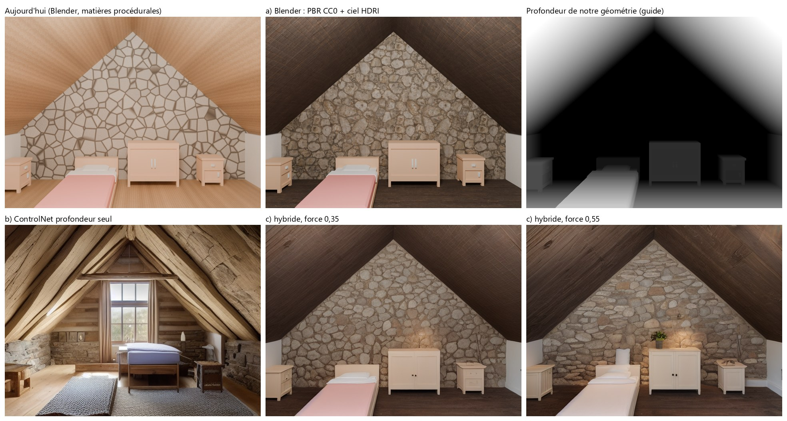
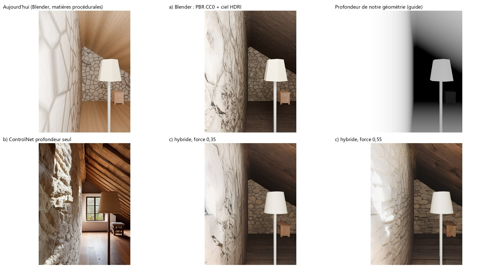

# 09 — Cadrage : rendu « design » (R4)

*Note de cadrage, 4 octobre 2026. Demande d'augus relayée par le PO (3 oct. 21:43) : viser le
niveau de la photo de référence `data/bugs/2026-10-03-reference-rendu-design.jpg` (grenier
aménagé haut de gamme : bois, pierre, lumière naturelle par les velux, lits, tapis, décor), en
respectant le point de vue, les dimensions et l'architecture connues par le moteur. Aucun code
du produit n'est écrit avant validation de cette note.*

## 1. Ce que le rendu doit tenir

| Exigence | Pourquoi | Mesure |
|---|---|---|
| Point de vue = celui choisi (photo ou point de vue posé) | comparer avec la photo, montrer « sa » pièce | même caméra que le rendu Blender |
| Cotes et architecture tenues | c'est la valeur d'OpenPlan face à un générateur d'images | murs, pentes, ouvertures et meubles à leur place, à ±2 % dans l'image |
| Aspect « photo d'architecte » | demande d'augus | jugé sur planche, côte à côte avec la référence |
| Gratuit et local, RTX 6 Go | directives « gratuit avant tout », vie privée | VRAM de pointe < 5,5 Go, rien ne quitte la machine |
| Licences CC0 ou équivalent pour les contenus, poids acceptés | règle du projet | page officielle vérifiée, registre comme `assets/furniture/SOURCES.yaml` |
| Honnêteté | une image retouchée par IA n'est pas un rendu des cotes | marquage `generated`, mention sous l'image |

## 2. Point de départ

- **Rendu actuel** (8d, R1b) : Blender 4.2 Cycles sur GPU, matières procédurales (bois, pierre,
  enduit), soleil et ciel uni selon le nord, appoints intérieurs ; meubles low-poly Kenney
  depuis F2. Lisible mais « maquette » (voir planches, case 1).
- **Déjà installé et accepté** : Stable Diffusion 1.5 + ControlNet profondeur v1.1 (CreativeML
  OpenRAIL-M, `openplan models pull … --accept-license`), utilisés par l'image d'inspiration
  (8e) à partir de la profondeur de la *photo*. Rien de nouveau à télécharger pour les pistes b
  et c.
- **Manque structurel** : le modèle de scène n'a pas d'ouverture dans un versant (velux) ; or
  c'est la lumière principale de la référence. Les murs pignons sont en enduit par défaut.

## 3. Essai (4 oct. 2026, 02:20–02:40)

Script `scratchpad/r4/trial.py`, rien dans le dépôt. Deux scènes : le grenier synthétique de la
fabrique (`attic_project`) et une **copie en mémoire** du projet grenier d'augus `648abafa…` (6
murs, 2 versants, 3 ouvertures, caméra de sa photo) ; son projet n'est pas modifié. Même
ameublement pour tous les rendus, posé par le générateur de la bibliothèque (2 lits simples, 2
chevets, commode, lampadaire). Pignons en pierre.

- **A0, aujourd'hui** : rendu Blender actuel, 64 échantillons.
- **a) Blender réaliste** : matières PBR de Poly Haven (couleur, normales, rugosité en
  projection boîte : `old_wood_floor`, `coral_stone_wall`), ciel HDRI
  `kloofendal_48d_partly_cloudy_puresky` qui éclaire par les ouvertures, AgX, 128 échantillons.
  Licence CC0 vérifiée sur https://polyhaven.com/license (aucune attribution exigée) ;
  ambientCG également CC0 (https://docs.ambientcg.com/license/). Fichiers et SHA-256 dans
  `~/.cache/openplan-r4/manifest.json` (≈ 10 Mo en 1K), hors du dépôt.
- **b) Diffusion guidée par notre géométrie** : passe de profondeur Cycles depuis la caméra
  choisie → ControlNet profondeur SD 1.5, prompt « grenier rénové, poutres, pierre, chêne clair,
  lin, jute, lumière du jour », 30 pas, 640 px.
- **c) Hybride** : le rendu a) en entrée img2img + la même profondeur en ControlNet, force 0,35
  et 0,55.

### Mesures (RTX PRO 500 Blackwell 6 Go)

| Rendu | Synthétique | Grenier d'augus | VRAM de pointe |
|---|---|---|---|
| A0 Blender actuel (64 éch., 1280 × 960) | 14 s | 18 s | — (Cycles) |
| a) PBR + ciel (128 éch.) | 17 s | 22 s | — (Cycles) |
| b) ControlNet seul (30 pas, 640 px) | 15 s | 15 s | 3,7 Go |
| c) hybride, force 0,35 | 5 s | 5 s | 3,7 Go |
| c) hybride, force 0,55 | 8 s | 9 s | 3,7 Go |

Temps de diffusion hors chargement du modèle (≈ 10 s la première fois).

### Ce que montrent les images

| | Aspect | Fidélité (cotes, architecture, meubles) | Verdict |
|---|---|---|---|
| A0 | maquette, matières plates | exacte | base honnête, pas « design » |
| a) | pierre crédible, profondeur ; bois choisi trop sombre, peu de lumière du jour (pas de velux) | exacte | nécessaire, insuffisant seul |
| b) | le plus proche de la référence (charpente, lumière, tapis) | **non tenue** : une fenêtre et des poutres inventées, lit déplacé, meubles changés | inspiration seulement (c'est déjà 8e) |
| c) 0,35 | a) affiné : matières plus naturelles, meubles plus réalistes | tenue (mêmes meubles, mêmes places) | bon compromis |
| c) 0,55 | plus « photo », lumière plus riche, quelques détails ajoutés (plante, applique) | tenue pour l'architecture et les meubles ; petits objets inventés | limite haute |

Le point de vue de la photo d'augus est collé au mur latéral (caméra estimée) : sur ce cadrage,
aucune piste n'approche la référence, qui est une vue frontale centrée. Le cadrage fait autant que
les matières.

## 4. Les trois pistes, comparées

| | a) Blender réaliste | b) Diffusion guidée seule | c) Hybride |
|---|---|---|---|
| Qualité visée | bonne si matières, lumière (velux) et décor sont soignés ; plafond « 3D propre » | la plus « photo », mais au hasard | proche de b, sur la structure de a |
| Fidélité aux cotes | exacte (c'est la géométrie) | faible : la profondeur guide, le modèle invente | exacte pour murs, pentes, meubles ; détails ajoutés possibles |
| Temps | 15–60 s selon échantillons | 15 s | Blender + 5–10 s |
| VRAM | Cycles seul | 3,7 Go | 3,7 Go (après Blender, pas en même temps) |
| Licences | Poly Haven / ambientCG CC0 vérifiées ; meubles Kenney CC0 | SD 1.5 + ControlNet OpenRAIL-M, déjà acceptés | les deux |
| Risque | travail de contenu (matières, décor, velux) | trompe sur le résultat | doit être marqué `generated`, force à borner |

**Modèles plus récents** (non téléchargés, licences à vérifier à la source avant toute
demande) : SDXL + ControlNet SDXL (Open RAIL++-M d'après les fiches, mais ≈ 7 Go en fp16 : ne
tient pas en 6 Go sans déchargement CPU, 1–2 min par image) ; FLUX.1 [schnell] (Apache-2.0
annoncée, 12 G paramètres : hors de portée en 6 Go sans quantification lourde) ; FLUX.1 [dev]
(licence non commerciale) **exclu** ; SD 3.5 Medium (Stability Community License, conditions
de chiffre d'affaires) **écarté** tant qu'une licence plus simple suffit. SD 1.5 reste le choix
raisonnable pour 6 Go.

## 5. Recommandation

**Piste c, construite sur une piste a renforcée.** Blender fait la vérité (géométrie, lumière,
meubles de la bibliothèque) ; la diffusion fait la finition photo à force bornée (0,35 par
défaut, 0,55 au plus), guidée par la profondeur de notre rendu (essayée ici) et, si l'essai de D5 le
justifie, par ses arêtes (ControlNet canny SD 1.5, même licence OpenRAIL-M, **non installé :
téléchargement soumis à ton accord**) pour ne rien déplacer. Le rendu Blender reste toujours disponible à côté, et l'image finie est marquée
`generated` : « finition IA sur le rendu des cotes ». La piste b reste l'image d'inspiration
existante (8e), sans changement.

Ce qui fera le plus pour se rapprocher de la référence, dans l'ordre : (1) des velux et la
lumière du jour qui entre par eux ; (2) des matières claires de qualité (chêne clair, pierre,
lin) ; (3) un cadrage frontal proposé automatiquement pour un grenier ; (4) du décor (tapis,
lampes, linge de lit) ; (5) la finition IA.

## 6. Découpage proposé

| Étape | Contenu | Validation |
|---|---|---|
| D1 | **Velux** : ouverture dans un versant (schéma, ops, plan 2D, 3D, Blender, éclairage par le ciel) | test de schéma, rendu de la fixture, e2e |
| D2 | **Matières CC0** : registre `assets/materials/SOURCES.yaml` (Poly Haven / ambientCG, licence vérifiée, SHA-256, test refusant un fichier sans source), 6–8 matières 1K (chêne clair, chêne ancien, sapin, pierre, enduit, lin, jute), choix par élément dans la fiche ; ciel HDRI CC0 | test de licence, planche avant/après |
| D3 | **Lumière et cadrage** : réglages Cycles (AgX, échantillons, débruitage), « vue d'architecte » proposée (frontale, à hauteur d'œil, au centre de la pièce) en plus de la vue de la photo | planche, temps < 60 s à 1280 × 960 |
| D4 | **Décor** : tapis (objet au sol traversable, en réserve depuis F5), linge de lit, lampes, cadres, dans la bibliothèque (Kenney / Poly Haven CC0) | catalogue + test de licence |
| D5 | **Finition IA** (piste c) : profondeur en ControlNet (arêtes en plus seulement si tu acceptes le téléchargement du ControlNet canny), force bornée, prompt issu du type de pièce et d'un style choisi (« chalet », « scandinave », « industriel »…), marquage `generated`, rendu Blender gardé à côté | test du marquage, essai réel sur les deux scènes |

D1 à D4 améliorent le rendu fidèle sans IA ; D5 n'arrive qu'ensuite. Chaque étape est un
commit, avec planche avant/après dans le message.

## 7. Questions au PO

1. Valider la piste c sur base a, et l'ordre D1 → D5.
2. Les velux (D1) touchent le format de scène : OK pour une version du schéma ?
3. Matières : 1K suffit-il (≈ 2–3 Mo par matière, ≈ 20 Mo en tout dans le dépôt), ou faut-il
   un téléchargement à la demande hors du dépôt ?
4. Finition IA : par défaut désactivée (bouton « Finition IA ») ou proposée systématiquement
   après le rendu ?
