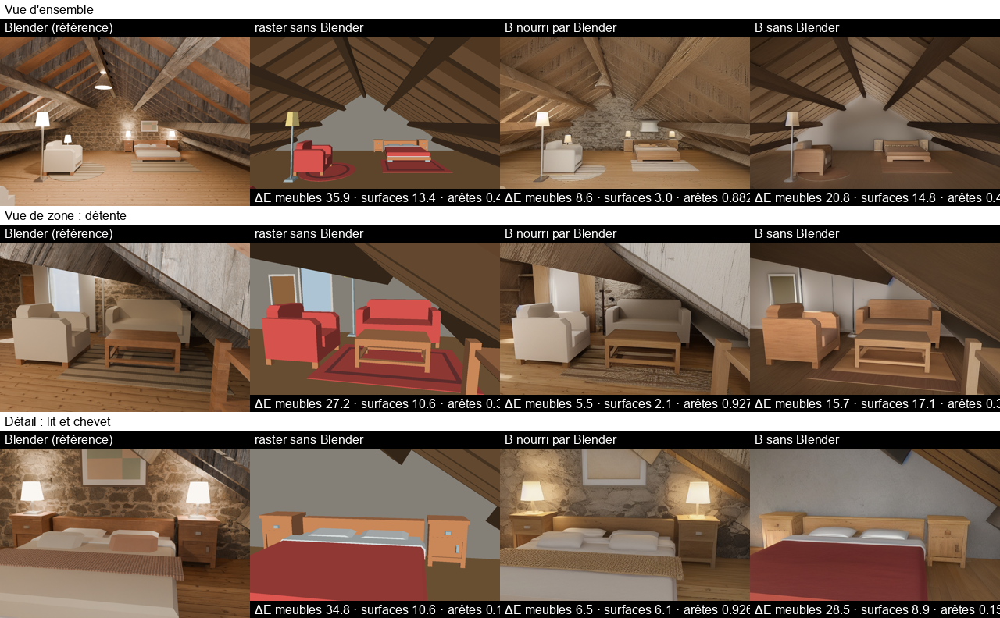

# 11 — Blender : en a-t-on besoin ?

Statut : note de décision, demandée par augus le 6 octobre 2026 (16 h 30), sans code produit.
Mesures faites le 6 octobre sur la machine d'augus (RTX PRO 500, 6 Go), sur une copie de la
photo 2 des combles ; projet d'augus intact.

## Réponse courte

**Garder Blender, et le garder optionnel comme aujourd'hui. Ne pas le remplacer.** C'est lui
qui donne les matières : textures CC0, teintes du style, bois des meubles, lumière du jour et
lampes. L'image d'inspiration B, dont le chemin automatique tire son allure de photo, les tient
parce qu'elle part de l'image Blender. Nourrie sans Blender, B garde la géométrie mais perd les
matières : l'écart de couleur passe de 6–9 à 16–29 (ΔE), la pierre disparaît, la lumière
s'aplatit (essai ci-dessous). Ce que Blender coûte (1,3 Go installé, 16–18 s et 0,8 Go de VRAM
par vue) est petit à côté du modèle d'images (4,1 Go de poids, 5,4 Go de VRAM, 30 à 35 s par
vue pour A et B ensemble).

## 1. Où Blender sert aujourd'hui

| Usage | Appel | Sans Blender aujourd'hui |
|---|---|---|
| Rendu A (référence) de chaque vue | `render_camera_view` (Cycles, 64 éch., GPU, débruitage) | pas de rendu ; message « Blender introuvable » |
| Image de départ, profondeur et arêtes de B | `preview.png` + `depth_z.npy` du même rendu ; arêtes Canny sur l'image | pas de B |
| Finition IA (A) | part de `preview.png` et `depth_z.npy` | pas de finition |
| Vignettes Blender des variantes (3.7) | `render_proposal` (32 éch.) | vignette 3D du navigateur seulement |
| Rendus en coupe (E3) | `run_blender(section=…, backdrop=…)` | coupe visible dans l'aperçu 3D seulement |
| Sonde d'exposition (D3) | un rendu réduit avant chaque rendu, pour régler l'exposition | — |
| Matières Poly Haven CC0 (D2, V1.3) | textures PBR, projection boîte ou UV des pentes, teintes et saturation | teintes plates dans le GLB |
| Teintes du style sur les meubles (V1.3) | `kenney_material` : bois, tissu, métal selon le style | couleurs d'origine des modèles Kenney |
| Lumière du jour et lampes (D3, D4) | soleil d'après le nord, ciel HDRI, suspension, lampes de chevet allumées | éclairage uniforme |
| Export `.blend` | `openplan blender` | — |

Le script `blender/scripts/build_scene.py` (1 349 lignes, GPL-3.0-or-later, séparé du reste
Apache-2.0) reçoit le bake JSON et ne dépend que de `bpy`.

## 2. Ce qu'il coûte

| Poste | Mesure |
|---|---|
| Installation | Blender 4.2.5 LTS portable, **1,3 Go** dans `~/opt/blender` ; gratuit (GPL), pas de compte ; non fourni par `pip install openplan-studio` : téléchargement à part, puis `OPENPLAN_BLENDER_BIN` (le diagnostic `openplan doctor` le dit) |
| Temps par vue | **16 à 18 s** (64 éch., GPU, sonde d'exposition comprise) ; moyenne des durées rangées : 16,4 s |
| VRAM | **0,8 Go** de pointe pendant un rendu (contre 5,4 Go pour le modèle d'images) |
| Fragilité | processus séparé : lancement, script GPL, versions (testé en 4.2 LTS seulement) ; les échecs sont dits (« Blender a dépassé 600 s », « introuvable ») ; problème vu : un test de rendu instable à cause du ciel HDRI derrière une vitre (contourné dans les tests) |
| Dépendance pour l'utilisateur | la seule installation manuelle hors `pip` et hors poids ; sans elle, l'éditeur, le plan, la 3D du navigateur et les exports marchent, mais pas les rendus du chemin automatique |

Pour mémoire, le reste du chemin : 4,1 Go de poids (SD 1.5, ControlNet profondeur et arêtes,
profondeur, OWLv2), 21 Mo de matières CC0. Durées rangées sur cette machine : finition 9,5 à
16 s, inspiration 20 s par vue.

## 3. Alternatives réalistes et gratuites

| Alternative | Principe | Ce qu'on gagne | Ce qu'on perd |
|---|---|---|---|
| **three.js dans le navigateur** (la 3D actuelle) | rastérisation WebGL de la scène GLB, éventuellement un path tracer WebGL (three-gpu-pathtracer) | aucune installation ; aperçu instantané ; le même moteur que l'aperçu | aujourd'hui pas de textures ni de teintes du style dans le GLB (à ajouter) ; path tracer WebGL lent sur un GPU portable et dépendant du navigateur ; rendus côté client, donc hors du chemin automatique serveur (le chemin devrait attendre l'onglet ouvert) |
| **three.js sans tête** (Node + headless-gl ou Chrome) | le même rendu côté serveur | rendus serveur sans Blender | une pile Node/Chrome à installer à la place (Playwright est déjà là pour les tests) ; mêmes manques de matières que ci-dessus ; qualité d'un rastériseur, pas d'un lancer de rayons |
| **pyrender / trimesh** | rastérisation OpenGL (pyrender) ou z-buffer maison (trimesh + numpy, essai ci-dessous) | profondeur et arêtes en 1 à 3 s ; pur Python | pas de textures ni de lumière réaliste ; pyrender demande OpenGL/EGL (non installé ici) |
| **Filament** | moteur PBR temps réel de Google (Apache-2.0) | rendu PBR rapide, matières correctes | binding Python peu maintenu ; intégration lourde (matériaux compilés) ; aucun gain clair sur Cycles pour une image fixe |
| **Rien d'autre que SD sur des cartes rastérisées** | profondeur et arêtes rastérisées, B en txt2img ou img2img sur une image plate | le plus léger | matières et lumière inventées : c'est le B « sans Blender » mesuré ci-dessous |

### Effet sur A, B et la North Star

- **A (référence)** n'existe qu'avec un vrai rendu : sans Blender, A devient l'aperçu
  rastérisé, qui n'est pas publiable (couleurs plates, pas de lumière).
- **B** a besoin d'une image de départ qui porte déjà les matières : le rastériseur ne les
  porte pas (voir l'essai). Pour s'en passer, il faudrait refaire dans le GLB les textures CC0,
  les teintes du style et une lumière crédible : c'est refaire `build_scene.py` en WebGL.
- **North Star** (≥ 3 vues publiables, 0 geste, < 5 min) : tenue aujourd'hui avec Blender (157 s
  sur la photo 2). Sans Blender, le temps baisserait d'environ 50 s (3 rendus), mais les vues ne
  seraient plus « publiables » au sens des planches.

## 4. Essai mesuré : B nourri sans Blender

Méthode (script du dossier de travail, sans code produit) : la scène du GLB (trimesh, 3 044
triangles, teintes plates par matière, modèles Kenney) est rastérisée par un z-buffer numpy
depuis la caméra de chaque vue (découpe au plan proche, ombrage de Lambert), d'où une image
couleur, une profondeur et des arêtes. B (img2img 0,8, profondeur et arêtes à 1,2, même prompt,
même graine) en est nourri, puis comparé à B nourri par Blender et à l'image Blender, sur les
3 vues automatiques de la photo 2.

| Vue | Méthode | Meubles retrouvés | ΔE meubles | ΔE surfaces | Arêtes F1 | Temps |
|---|---|---|---|---|---|---|
| Ensemble (5 visibles) | rastérisé seul | 4 | 35,9 | 13,4 | 0,44 | 2,6 s |
| | B nourri par Blender | 5 | 8,6 | 3,0 | 0,88 | 16 s + 20 s |
| | B sans Blender | 4 | 20,8 | 14,8 | 0,43 | 2,6 s + 27 s |
| Zone détente (6) | rastérisé seul | 3 | 27,2 | 10,6 | 0,33 | 1,6 s |
| | B nourri par Blender | 5 | 5,5 | 2,1 | 0,93 | 16 s + 20 s |
| | B sans Blender | 4 | 15,7 | 17,1 | 0,34 | 1,6 s + 21 s |
| Lit et chevet (4) | rastérisé seul | 0 | 34,8 | 10,6 | 0,14 | 1,3 s |
| | B nourri par Blender | 3 | 6,5 | 6,1 | 0,93 | 16 s + 20 s |
| | B sans Blender | 3 | 28,5 | 8,9 | 0,16 | 1,3 s + 19 s |

ΔE : écart de couleur moyen (Lab) avec l'image Blender, au centre de chaque meuble et sur le
sol et le pignon ; arêtes : F1 des arêtes Canny contre l'image Blender, tolérance 3 px (les
textures de Blender comptent dans les arêtes, ce qui pénalise toute image sans texture).

Lecture :
- **la géométrie tient** sans Blender : même cadrage, mêmes meubles retrouvés par OWLv2 (3 à 4
  par vue contre 3 à 5) ;
- **les matières ne tiennent pas** : le canapé et le jeté de lit rouges des modèles Kenney
  passent tels quels (les teintes du style n'existent que dans Blender), le pignon de pierre
  devient un enduit lisse, le pin un brun uni ; B invente ensuite à partir de ces aplats ;
- **la lumière s'aplatit** : ni lampes allumées, ni soleil, ni ciel ;
- **le gain de temps** est réel mais limité : 1,3 à 2,6 s au lieu de 16 à 18 s par vue, soit
  environ 45 s sur les 157 s du chemin.

## 5. Recommandation

**Garder Blender, optionnel comme aujourd'hui.** Il reste le moteur de la référence A et la
source des matières de B. Le remplacer demanderait de refaire en WebGL ce que fait
`build_scene.py` (textures CC0, teintes du style, lumière), pour un gain d'environ 45 s et de
1,3 Go d'installation, avec une qualité de rastériseur.

Ce qui vaudrait la peine, à décider plus tard :
1. **Faciliter l'installation** : une commande `openplan blender install` qui télécharge
   Blender 4.2 LTS portable (site officiel, empreinte vérifiée) dans `~/opt` et règle
   `OPENPLAN_BLENDER_BIN` ; téléchargement explicite, comme les poids. *Demande l'accord
   d'augus avant tout téléchargement.*
2. **Un repli sans Blender clairement marqué** : si Blender manque, le chemin automatique
   pourrait produire des vues « aperçu » (rastérisées, sans B), marquées comme telles, au lieu
   de s'arrêter aux vues sans rendu. Petit travail, utile pour un premier essai.
3. **Porter les teintes du style dans le GLB** (déjà relevé comme limite en V1.3) : l'aperçu 3D
   du navigateur ressemblerait davantage au rendu, sans toucher au rôle de Blender.
